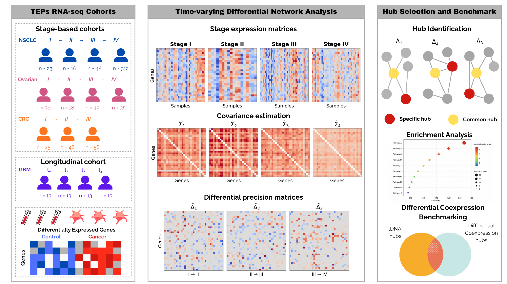

# Temporal and stage-based analysis of tumor-educated platelet transcriptomes reveals network-rewiring signatures across cancer progression

Code for the study **“Temporal and stage-based analysis of tumor-educated platelet transcriptomes reveals network-rewiring signatures across cancer progression.”**

This repository contains the computational workflow for analyzing tumor-educated platelet (TEP) RNA-seq data across cancer stages and longitudinal follow-up time points.

## Study overview

The workflow applies time-varying differential network analysis (tDNA) to identify changes in gene–gene conditional dependencies across consecutive tumor stages or follow-up time points.

The study analyzes TEP RNA-seq cohorts for:

- Non-small cell lung cancer (NSCLC)
- Ovarian cancer
- Colorectal cancer (CRC)
- Glioblastoma (GBM)

The analysis identifies common and transition-specific hub genes, performs functional enrichment, and compares tDNA results with conventional differential co-expression analysis.

## Workflow

1. Preprocess the RNA-seq data.
2. Identify differentially expressed genes.
3. Infer differential networks across consecutive stages or time points using tDNA.
4. Identify common and transition-specific hub genes.
5. Perform functional enrichment analysis.
6. Benchmark the results against differential co-expression analysis.

## Repository contents

The repository contains the notebooks and scripts used for the analyses. See the files in this repository for the workflow and analysis-specific instructions.

## Requirements

The analyses use Python and Jupyter Notebook for tDNA, and R for data preprocessing and differential co-expression analysis.

The manuscript reports Python 3.12.3. See the repository’s environment or dependency files for package requirements and versions.

## Running the analyses

1. Clone or download this repository.
2. Prepare the input data as described in the relevant notebook or script.
3. Install the dependencies specified by the repository’s environment or dependency files.
4. Run the notebooks or scripts in the order indicated by the workflow.

Random seeds and analysis settings are specified in the corresponding notebooks or scripts.

## Data

The study uses tumor-educated platelet RNA-seq datasets from the Gene Expression Omnibus (GEO). Dataset accessions, cohort details, and selection criteria are reported in the manuscript.

## Citation

If you use this code, please cite the associated study:

Rinaldi S., Vessi S., Asquino A., Rughetti A., Farina L., Petti M.  
*Temporal and stage-based analysis of tumor-educated platelet transcriptomes reveals network-rewiring signatures across cancer progression.*

## License

Add the license that applies to this repository.
